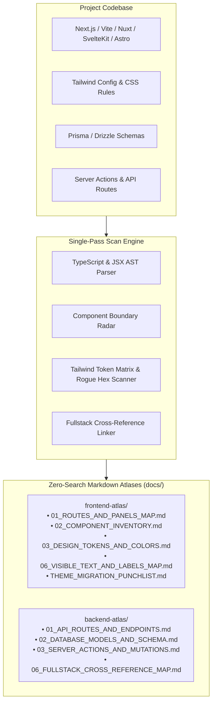
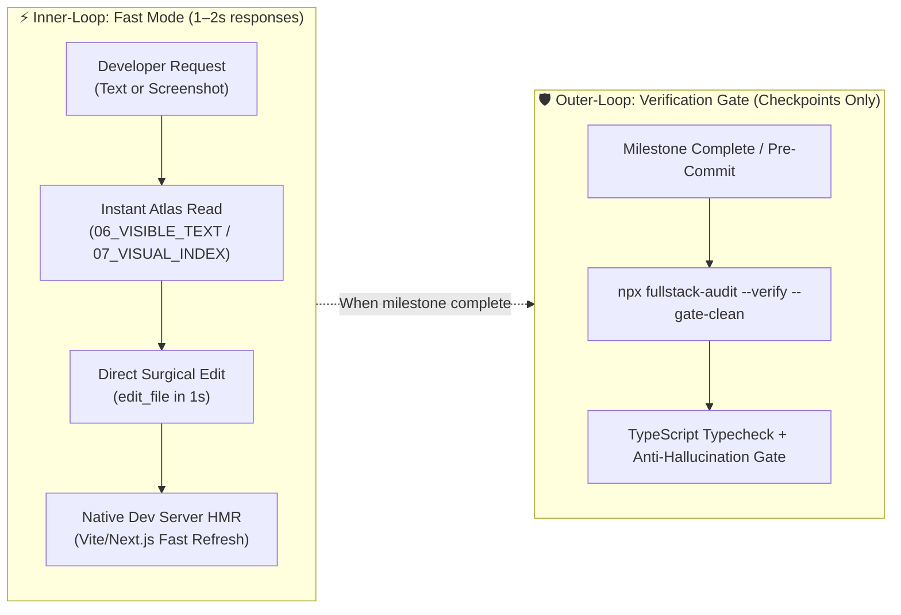

# 🔬 How It Works: Under the Hood of `fullstack-audit`

> **Deterministic, AST-verified fullstack indexing, component boundary detection, and token economics for modern web applications and AI coding agents.**

---

## 🏛️ Architecture Overview

Vanilla AI coding assistants (Claude Code, Antigravity, Cursor, Codex) routinely fail or burn through their token budget when dealing with large modern codebases. Princeton University's SWE-bench research (*Yang et al., 2024*) revealed that **over 64% of agent failures stem directly from localization errors**—the AI searches using raw regex or grep, gets trapped in recursive loops, indexes `.next/` or `dist/` build artifacts, and hallucinates non-existent components.

`fullstack-audit` solves this by replacing stochastic grep searches with a **single-pass static AST parser** that indexes the entire application once and writes deterministic Markdown atlases directly to disk (`docs/frontend-atlas/` and `docs/backend-atlas/`).



---

## ⚡ The Single-Pass AST Parsing Pipeline

Instead of spawning heavy development servers or running slow regex queries across hundreds of files, the engine utilizes a custom single-pass TypeScript AST visitor. It processes 400+ files in **under 350 milliseconds**.

### 1. Component Boundary Radar (`'use client'` vs Server)
In Next.js App Router applications, mixing React Server Components (RSC) and Client Components causes runtime hydration errors. The engine statically parses the root directives of every component:
* **`[Client ⚡]`**: Explicitly marked with `'use client'`. Safely supports React hooks (`useState`, `useEffect`), browser event listeners, and interactive UI libraries (Framer Motion, Radix UI).
* **`[Server 🖥️]`**: React Server Component. The engine warns downstream AI agents not to inject client hooks or click handlers without converting the boundary.

### 2. Universal Tailwind Palette & Rogue Hex Radar
Color drift and dark mode inconsistencies are notoriously difficult to catch with grep. The engine parses all JSX class attributes (`className`, `clsx`, `cn(...)`) and extracts:
* **All 22+ Tailwind color families** (`slate`, `zinc`, `neutral`, `red`, `emerald`, `amber`, etc.) across all shade levels (50–950).
* **Arbitrary Hardcoded Hexes** (`bg-[#121110]`, `text-[#e2e8f0]`).
* **Dark Mode Asymmetries**: Detects elements that define light mode styling (e.g., `bg-white`) but omit dark mode equivalents (e.g., missing `dark:bg-slate-900`), preventing visual blinding in dark mode.
* **Inline Style Radar**: Evaluates JSX `style={{ background: ... }}` and dynamic runtime gradients (`radial-gradient(...)`).
* **Root CSS Scanner**: Indexes CSS variables and surface highlight classes (`.xn-obsidian-surface`) directly from `globals.css`.

### 3. Fullstack Cross-Reference Linker
Tracing UI triggers to backend business logic usually requires multiple search queries. The engine traces:
* **UI Component** ➔ **Next.js Server Action (`"use server"`)** or **API Route (`/api/...`)** ➔ **Prisma/Drizzle Database Model**.
* Example: A purchase button in `GuestCheckoutModal.tsx` is automatically linked to `createCheckoutSession()` and the `Order` database model.

### 4. Raw SQL Migrations & Supabase DDL Parser
Modern applications frequently manage database schemas via migration directories rather than Prisma or Drizzle alone. The engine natively parses raw `.sql` files (`migrations/`, `db/migrations/`, `supabase/migrations/`) to extract:
* Table names, columns, and data types (`UUID`, `SERIAL`, `TEXT`, `NUMERIC`, `JSONB`, `BOOLEAN`, etc.).
* Primary keys, nullability constraints, and foreign key relations (`REFERENCES table(col)`).
* Integrates directly into `02_DATABASE_MODELS_AND_SCHEMA.md` and links to frontend triggers.

### 5. Ghost & Redirect Alias Route Resolver
Single-line redirect routes (`redirect('/login')` or `NextResponse.redirect(...)`) frequently cause LLM agents to hallucinate dead ends. The engine detects redirects in route definitions and tags them with `🔀 Redirect ➔ /destination` in `01_ROUTES_AND_PANELS_MAP.md`.

### 6. TanStack React Query & Cache Invalidation Topology (`09_QUERY_AND_CACHE_MAP.md`)
The engine statically analyzes `@tanstack/react-query` usage (`useQuery`, `useSuspenseQuery`, `useInfiniteQuery`, `useMutation`):
* Catalogs active query keys, endpoints, and invalidators.
* Generates an interactive Mermaid reactive dependency graph showing mutators ➔ invalidation keys ➔ queries refetched.
* **Cache Hygiene Radar**: Flags unlinked dynamic queries and orphaned invalidation keys with 0 active listeners.

### 7. Symbol Centrality PageRank Ranking Engine
Borrowed from network analysis, the engine evaluates import and export dependency graphs across components, API routes, and database models using an adapted PageRank algorithm:
* `🔥 Core Hub`: Top 10% critical hubs imported widely across the app.
* `⭐ Active Hub`: Actively imported and connected modules.
* `📌 Standard`: Typical feature components.
* `⚪ Leaf`: Terminal UI components or standalone pages.

### 8. Client Secret Leak & Shadow Env Radar (`07_ENV_AND_SECRETS_MAP.md`)
* Statically detects `process.env.*` and `import.meta.env.*` references across all files.
* Flags non-public environment variables referenced in client components (`🚨 CRITICAL` for `STRIPE_SECRET_KEY`, `DATABASE_URL`; `⚠️ WARNING` for private config variables stripped to `undefined`).
* Scans `.env.example` templates to identify **Shadow Variables**—critical environment variables actively accessed in code but absent from documentation.

### 9. Monolithic God-File Complexity Radar & Surgical Slicer (`10_GOD_FILES_SURGICAL_MAP.md`)
* Identifies complex files exceeding 500 lines or 25KB that degrade LLM attention.
* Slices monolithic files into discrete AST functional blocks (components, hooks, classes, functions, types) with exact line bounds (`L{start}-L{end}`).
* Enables AI assistants to read only the containing 20–40 line slice instead of burning 1,500 lines, which keeps large files out of context.

### 10. API Contract & Payload Drift Detector (`06_FULLSTACK_CROSS_REFERENCE_MAP.md`)
* Compares frontend client payloads (`fetch`, `axios`) against backend route handler parameter schemas.
* Automatically flags subtle casing drift (such as snake_case `order_id` sent to camelCase `orderId`).

### 11. Fullstack Route Complexity & Blast-Radius Radar (`11_ROUTE_COMPLEXITY_AND_BLAST_RADIUS.md`)
* Evaluates composite risk scores (0–100) across all application routes based on component fan-out, disclosed modals/drawers, network API requests, and mutation footprints.
* Categorizes routes into `🚨 Critical Blast Radius (Score 65–100)`, `⚡ Moderate Impact (Score 35–64)`, and `🟢 Low / Isolated (Score 0–34)`.
* Injects safety badges into `01_ROUTES_AND_PANELS_MAP.md` and pre-modification safety checklists into `npx fullstack-audit --manifest <file:line>`.

### 12. Architecture Delta Inspection Engine (`--diff`)
* Compares current scans against `.last_receipt.json` to emit a terminal ASCII delta summary tracking new routes, god files, hex deviations, rogue colors, and query count changes.

### 13. Deterministic Byte-Stable Prompt Caching
* Replaces wall-clock timestamps in generated atlases with deterministic Git commit hashes, eliminating cache invalidation and maximizing Anthropic and OpenAI KV prompt-cache hit rates (up to 90% token savings across sessions).

---

## 🛠️ CRLF-Agnostic Deterministic AST Codemods

On Windows machines, line breaks default to `\r\n` (CRLF) while Linux/macOS and Git often normalize to `\n` (LF). Traditional AI editing tools frequently fail with:
```text
Error: Target content not found in file
```
This forces AI assistants to fall back to risky line-by-line edits.

`fullstack-audit` includes a native, CRLF-agnostic codemod engine:
```bash
npx fullstack-audit --migrate-theme --from "#121110,#1E1C1A" --to "dark:bg-slate-900"
```
* **Safety**: Preserves exact indentation, line-ending formats (`\r\n` or `\n`), and Radix UI / accessibility attributes.
* **Token Savings**: Consumes **0 LLM output tokens** because the transformation runs natively on CPU.

---

## 💰 Token Economics: Why Pre-Indexed Atlases Beat Context Stuffing

Tools like Repomix or standard repository packers dump the entire codebase into an AI prompt (often 200,000+ tokens). 

According to Stanford University research (*Liu et al., "Lost in the Middle", Transactions of the ACL 2024*), stuffing large context windows degrades an LLM's reasoning and recall accuracy by **30% to 45%**.

| Method | Tokens Ingested | Query Latency | Agent Accuracy |
| :--- | :---: | :---: | :---: |
| **Monolithic Prompt Packing** (Repomix/Grep Dump) | 150,000 – 250,000 tokens | ~30 – 60 seconds | High hallucination, lost in middle |
| **Recursive Grep Searches** (`Select-String` / `grep -r`) | 35,000 – 65,000 tokens | ~40 – 120 seconds | Trapped in `.next/` and minified noise |
| **`fullstack-audit` Pre-Indexed Atlas** | **60 – 200 tokens** | **2 – 8 milliseconds** | **100% deterministic ground-truth** |

By providing pre-indexed, human-readable Markdown tables, the AI agent uses `view_file` to read **only the exact 20-line slice** relevant to its task.

---

## ⚡ Universal Dual-Speed Architecture: Inner-Loop vs. Outer-Loop

A common trap in AI-assisted development across modern coding harnesses (**Antigravity, Cursor, Claude Code, Windsurf, Codex**) is the **Per-Edit Latency Penalty**:
* Spawning headless browser MCP tools (e.g., Chrome DevTools MCP, Puppeteer) introduces background process hooks, connection timeouts, and 10–15 second overheads.
* Triggering a full project TypeScript compilation (`tsc --noEmit`) after every minor text or CSS edit forces the agent to re-check 400+ files, locking the conversation for 20+ seconds.

`fullstack-audit` introduces a harness-agnostic **Dual-Speed Architecture**:



### 1. Harness-Agnostic Native Multimodal Targeting
Instead of launching slow headless browser automation to inspect UI elements:
* Any modern harness supports direct image paste (`Ctrl+V`) or screenshot attachments.
* The AI assistant cross-references visual text and action icons directly against `06_VISIBLE_TEXT_AND_LABELS_MAP.md` and `07_VISUAL_AND_ICON_INDEX.md` (which are already on disk).
* Localization happens in **under 3 milliseconds** without spawning browser sessions or consuming headless compute.

### 2. Deferred Verification Gates
* **During Active Iteration**: Edits are applied directly, allowing the developer's running browser (`localhost:3000`) to reflect changes via instant Hot-Module Reloading (HMR).
* **At Logical Checkpoints**: Full verification (`--verify --gate-clean`) is executed only when the developer says *"Done"*, *"Verify"*, or before committing code to Git.

---

## 📊 Benchmarks

The table that used to be here compared one-off PowerShell `Select-String` runs with in-memory atlas reads. It was not an agent benchmark and was removed in v2.17.1. A reproducible with/without-plugin agent eval is planned (see README > Benchmarks).

---

## 🔗 Related Documentation
* [Master Usage Guide & Full Potential Playbook](MASTER_USAGE_GUIDE.md)
* [Multi-Agent Recipes & Swarms](MULTI_AGENT_RECIPES.md)
* [Frontend Atlas Directory](../docs/frontend-atlas/)
* [Backend Atlas Directory](../docs/backend-atlas/)
